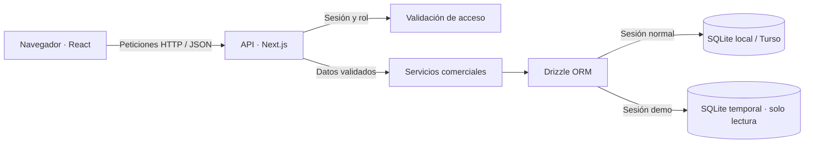
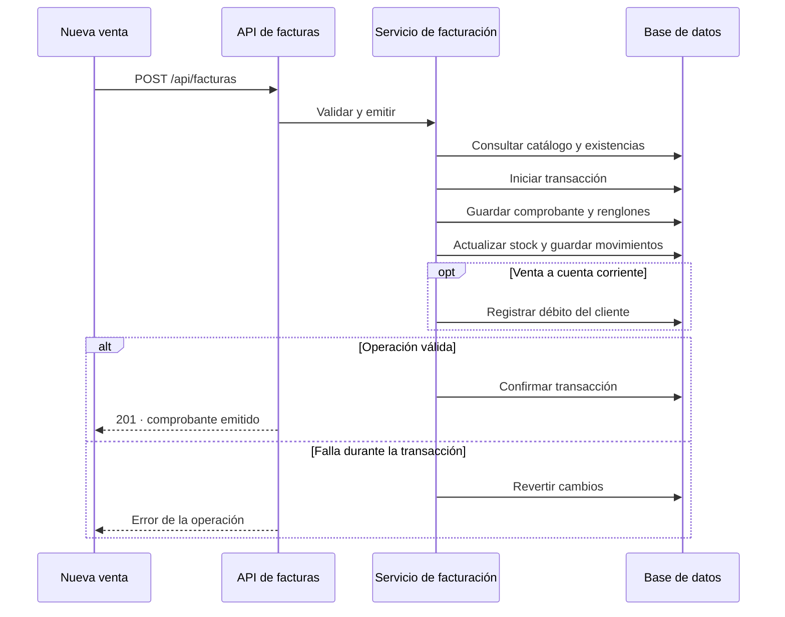

# Mostrador

Mostrador es una aplicación web de gestión comercial minorista. Integra ventas, inventario y cuentas corrientes. Al confirmar una venta, registra el comprobante, actualiza las existencias y, si se vende a cuenta corriente, incorpora la deuda al historial del cliente.

[Explorar Mostrador](https://parcial2-sigma.vercel.app/login)

## Funcionalidades

| Módulo | Operaciones |
| --- | --- |
| Ventas | Carrito de mostrador, alta de clientes durante una venta, cálculo de vuelto y cobros de contado, con tarjeta simulada o a cuenta corriente. Historial con filtros y comprobantes internos imprimibles. |
| Inventario | Catálogo por categorías, búsqueda por código o descripción, activación y desactivación de productos, entradas y salidas manuales, historial de movimientos y alertas de stock bajo. |
| Clientes y cobranzas | Búsqueda por nombre o documento, límites de crédito, saldos por cliente, extracto de movimientos y registro de pagos con recibos internos imprimibles. |
| Tablero | Ventas del día y del mes, deuda pendiente, productos bajo el mínimo, evolución de ventas y distribución por medio de pago. |
| Acceso | Administración de usuarios y categorías para el rol administrador. El vendedor puede operar ventas, productos, stock, clientes y pagos. |

El login de la aplicación publicada ofrece acceso directo en **modo demo** como administrador o vendedor. La demo usa un SQLite temporal con datos de ejemplo y acceso de solo lectura. Para registrar operaciones se requiere una cuenta con contraseña.

## Arquitectura

La interfaz está construida con Next.js App Router, React, TypeScript y Tailwind CSS. Los Route Handlers exponen la API, Zod valida las entradas y los servicios aplican las reglas comerciales. Drizzle accede a SQLite local o a Turso en producción. El tablero usa Chart.js.



Las sesiones usan JWT firmados en cookies `HttpOnly`. En las sesiones normales, el servidor confirma que el usuario sigue activo y consulta su rol vigente. Las contraseñas se almacenan como hashes de bcrypt.

| Ruta | Responsabilidad |
| --- | --- |
| [`src/app/`](src/app/) y [`src/components/`](src/components/) | Páginas, formularios y componentes de interfaz |
| [`src/app/api/`](src/app/api/) | Rutas HTTP, sesión y respuestas |
| [`src/services/`](src/services/) | Facturación, stock, clientes, cobros y usuarios |
| [`src/db/`](src/db/) y [`drizzle/`](drizzle/) | Conexión, esquema y migraciones |

## Flujo de una venta

El cliente envía identificadores de productos y cantidades. El servidor toma los precios vigentes, calcula los importes y valida las reglas de la forma de pago. Dentro de una transacción guarda la factura, sus renglones y las salidas de stock. Para una venta a cuenta corriente también registra el débito.



La actualización de inventario impide que el stock quede negativo. Los comprobantes conservan los datos comerciales de la venta original, incluidos el precio unitario y la descripción de cada artículo. Los importes se almacenan en centavos enteros.

El saldo de cuenta corriente se calcula como débitos menos créditos. Al registrar un pago, el servicio comprueba el saldo y guarda el pago y su crédito en la misma transacción. Los comprobantes son internos y el pago con tarjeta es simulado.

## Instalación local

Requisitos: Node.js y pnpm. Desde la raíz del repositorio, ejecutá:

```bash
pnpm install
cp .env.example .env
pnpm db:deploy
pnpm dev
```

`pnpm db:deploy` aplica las migraciones y carga datos iniciales si la base no tiene usuarios. Accedé a [localhost:3000](http://localhost:3000/login) con `admin@comercio.test` o `vendedor@comercio.test`. Definí las contraseñas iniciales de esas cuentas en `.env` antes de inicializar la base.

| Comando | Acción |
| --- | --- |
| `pnpm lint` | Ejecuta ESLint sobre el código de la aplicación. |
| `pnpm db:generate` | Genera migraciones SQL a partir del esquema. |
| `pnpm db:migrate` | Aplica las migraciones pendientes. |
| `pnpm build` | Prepara la base y compila la aplicación. |
| `pnpm start` | Inicia la aplicación compilada. |

## Despliegue

El entorno de producción usa **Vercel** para la aplicación y **Turso** para la persistencia. El comando de compilación es `pnpm build`. Las variables se configuran en el entorno de producción.

| Variable | Uso |
| --- | --- |
| `DATABASE_URL` | URL de conexión de Turso |
| `DATABASE_AUTH_TOKEN` | Token de la base con permisos de escritura |
| `SESSION_SECRET` | Secreto de firma de al menos 32 caracteres |
| `SEED_ADMIN_PASSWORD` | Contraseña inicial de `admin@comercio.test` |
| `SEED_VENDEDOR_PASSWORD` | Contraseña inicial de `vendedor@comercio.test` |

Las contraseñas de inicialización de producción deben ser distintas y tener al menos 12 caracteres. Se usan al preparar una base sin usuarios. [Configuración de ejemplo](.env.example) · [Inicialización de la base](src/db/deploy.ts)

## Equipo

Francisco Agustín Delgado Ojeda · Oriana Daniela Gordillo · Sofía Cequi
